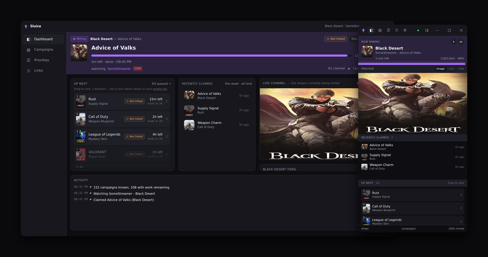

# Sluice

A browserless Twitch drop miner. No Chrome, no Puppeteer, no video download — it talks to
Twitch's GraphQL API directly and reports watch time the same way the web player does.

Written after studying [TychoTheTaco/Twitch-Drops-Bot][tycho] (the Puppeteer bot, dead since
2023) and [DevilXD/TwitchDropsMiner][devilxd] (Python, actively maintained). See
[ANALYSIS.md](ANALYSIS.md) for what each got right and why the browser-based one broke.

[tycho]: https://github.com/TychoTheTaco/Twitch-Drops-Bot
[devilxd]: https://github.com/DevilXD/TwitchDropsMiner



Two layouts from one build: a full dashboard, and a slim panel you can leave down the side
of a monitor. The desktop app and the container serve the same interface.

## What it does

**Mining**

- Watches the campaigns you can actually earn, ranked by rules you choose — ending soonest,
  tightest deadline, one game at a time, or by what you play most on Steam.
- Claims drops the moment they are earned, and moves on without being asked.
- Follows a campaign's allow-list when it has one, and finds a live channel when it does not.
- Pause, or skip to the next campaign, from either layout.
- Drag the queue to reorder it. That order is remembered, and is kept separate from your
  priority list, so ranking something for today does not enrol it forever.

**Knowing what it is doing**

- A live view of the current channel, drop progress, and the watch beat Twitch is counting.
- Says *why* nothing is being mined — everything claimed, nothing matching your settings,
  nothing running on Twitch, or nobody streaming it — and resumes on its own.
- Notices when another copy of Sluice is earning on the same account, which Twitch silently
  allows and silently only credits once.
- Warns before unclaimed progress on an unlinked campaign expires.
- An activity log, claim history, and totals for drops, campaigns and hours watched.

**Choosing what to mine**

- Restrict mining to games you own on Steam, plus anything you name yourself.
- Link Steam by signing in or by pasting your profile URL. No API key, yours or anyone's.
- Exclude games by name; Twitch's own categories, such as Special Events, are always mined
  because they are not games and cannot be owned.
- Rank campaigns whose reward cannot be delivered below ones that can, and see which
  publisher accounts are worth linking.

**Running unattended**

- A schedule, so it only mines during hours you choose.
- A daily cap on mining hours, with half an hour of latitude to finish a drop in progress.
- Starts with Windows, into the tray, and keeps mining when the window is closed.
- Desktop notifications for claims and completed campaigns, carrying the reward's artwork,
  with sounds you can turn off.
- Telegram and Discord notifications, set up through a guided flow rather than a config file.
- Updates itself, with the release notes in the app.

**Two ways to run it**

- A Windows desktop app that installs per-user and needs no administrator.
- A Docker container serving the same dashboard, comfortable on a Raspberry Pi.

## Why no browser

Every failure that killed the older bot traces back to driving Chrome: Twitch blocking the
stealth browser, the login page being rescraped after every redesign, DOM selectors rotting,
and integrity checks flagging automated browsers as bots. The GraphQL layer was never the
problem. This bot keeps that layer and throws the browser away.

Practical effect: a few HTTPS requests per minute and some idle websockets. Runs comfortably
on a Raspberry Pi.

## Docker

The image builds the daemon and the dashboard and serves both.

```sh
docker compose up -d --build
docker compose logs -f          # the login code appears here on first run
```

Then open <http://127.0.0.1:4400>.

Runtime state lives in `./data` (`config.json`, `auth.json`, `steam.json`), mounted as a
volume so credentials survive rebuilds. That directory is git-ignored; **never commit it** -
`auth.json` holds an OAuth token with full access to your Twitch account.

The port is published to `127.0.0.1` only. The container binds `0.0.0.0` because it must to
be reachable at all, but what is actually exposed is the mapping in `docker-compose.yml`. To
reach the dashboard from another machine, put it behind Tailscale or a reverse proxy rather
than widening that line - the dashboard has no login of its own.

If you have already logged in outside Docker, copy `auth.json` into `./data` and the
container will start already authorized.

## Setup (without Docker)

Requires Node 20+.

```sh
npm install
npm run build
npm start
```

On first run it writes a default `config.json` and prints a login code:

```
==========================================================
  Authorize this bot with your Twitch account:
  1. Open https://www.twitch.tv/activate?device-code=XXXXXXXX
  2. Enter the code:  XXXXXXXX
==========================================================
```

Open the link, enter the code, and the bot starts mining. Credentials are saved to
`auth.json` (mode 0600) and reused on later runs.

This uses the **OAuth device-code flow** — your password never touches this process, and
there is no 2FA prompt to scrape. To sign out, run with `--logout`.

> `auth.json` grants access to your Twitch account. Do not share or commit it. It is
> git-ignored by default.

## Configuration

`config.json`:

| Option | Default | Meaning |
| --- | --- | --- |
| `priorityGames` | `[]` | Games to mine, most wanted first. Display names or game IDs. Empty means any. |
| `excludedGames` | `[]` | Never mine these. |
| `priorityMode` | `"ending_soonest"` | How games outside `priorityGames` are ordered. See below. |
| `preferredChannels` | `[]` | Try these channels before searching the directory. |
| `campaignRefreshMinutes` | `20` | Minutes between campaign refreshes (minimum 5). |
| `attemptImpossibleCampaigns` | `true` | Work on campaigns that look too short to finish — they often get extended. |
| `switchOnCategoryChange` | `false` | Leave a channel the instant it switches to a category the campaign does not cover. Off by default: the stall watchdog already catches this within ~15 minutes, and enabling it costs a PubSub subscription per watched channel. |
| `autoClaimDrops` | `true` | Claim drops as soon as they are ready. |
| `autoClaimPoints` | `true` | Claim channel points bonuses while watching. |
| `warnUnlinkedAccounts` | `true` | Warn when rewards will not reach the game because accounts are not linked. |
| `allowedHosts` | `[]` | Extra `Host` values the dashboard answers to. Loopback names and the bound address are always accepted; add your own hostname when serving it behind a reverse proxy. |
| `logLevel` | `"info"` | `error`, `warn`, `info`, or `debug`. |
| `libraryPolicy` | `"ownedOrListed"` | Restrict mining to games you own on Steam or named in `priorityGames`. `"all"` mines any game with a campaign. Inert until a Steam library is loaded. |
| `steam` | `{}` | Steam library integration. See below. |
| `notifications` | `{}` | Optional Telegram / Discord webhooks. |

### Running only one copy at a time

Mining one Twitch account from two places at once is actively harmful: the two watch
sessions contradict each other, Twitch credits neither reliably, and both write the same
progress files. Two things now make that hard to do by accident.

An `instance.lock` beside the data directory stops a second process using the same files.
It carries a heartbeat, so a copy that was killed rather than closed does not lock you out
- the claim is taken over once it stops being refreshed.

A container and a desktop app cannot see each other's files at all, so that case is caught
differently: before mining, the bot asks whoever is already serving a dashboard on this
machine which account they are signed in as. If it is the same account, it refuses and says
where the other copy is answering. Nothing listening, a different program, or a different
account are all left alone.

Either way it stops before mining rather than after, and the dashboard stays up to explain
itself.

### Reaching the dashboard safely

The dashboard has no login, because it is meant to be reached from the machine it runs on -
Docker publishes it to `127.0.0.1:4400` and nowhere else. Two things are enforced anyway,
since "only on localhost" is weaker than it sounds:

- **Requests from other pages are refused.** A form post needs no preflight, so any site you
  visited could otherwise POST to the dashboard - signing you out and revoking your Twitch
  token without a line of script running on your own tab. Browsers attach `Origin` to those,
  and a cross-origin one is rejected. Tools that send no `Origin`, such as curl, still work.
- **Unknown `Host` headers are refused.** A hostile page can point a domain it controls at
  `127.0.0.1` and, once the browser's DNS cache turns over, its scripts are same-origin with
  whatever is listening there - able to read replies, not just send requests. Only loopback
  names, the bound address, and anything in `allowedHosts` are answered.

Neither helps against someone who can already reach the port directly. **If you want the
dashboard from another machine, put it behind something that authenticates** - a reverse
proxy with a password, a VPN, or an SSH tunnel - rather than publishing the port. Set
`allowedHosts` to the hostname that proxy serves it under.

### Which games get mined

Twitch runs campaigns for hundreds of games at once, and watch time spent on one you neither
own nor asked for earns a reward you cannot use. Once a Steam library is connected,
`libraryPolicy` defaults to `"ownedOrListed"`: a campaign is only mined if you own the game
on Steam, or the game is in `priorityGames`.

The priority list is the escape hatch, and it is why ownership alone is not the rule. Steam
cannot see an Epic or console title, and a Twitch category like "Special Events" is not a
game at all - putting either on the list mines it regardless.

Without a Steam library the policy is inert and everything is mined, since there would be
nothing to check ownership against. Set it to `"all"` to mine every game with a campaign, as
earlier versions did. Both are on the Settings page under "Which games to mine".

This is a separate question from whether a reward can reach you; see `unlinkedPolicy` for
that. A campaign has to pass both.

### Priority modes

Your `priorityGames` list always wins. `priorityMode` decides the order of everything below it:

| Mode | Orders remaining campaigns by |
| --- | --- |
| `ending_soonest` | Expiry date. The default. |
| `tightest_deadline` | Time left divided by minutes still needed, so near-misses come first. |
| `one_game_at_a_time` | Sticks with the current game until its campaigns are done. |
| `steam_playtime` | Games you own on Steam, most played first. |
| `steam_recent` | Games you own on Steam, most recently played first. |
| `random` | Reshuffled every refresh. |
| `priority_only` | Nothing outside the list is mined at all. |

### Steam library

Connecting Steam lets the bot rank campaigns by the games you actually own and play, and
shows which Twitch accounts are worth linking.

**No key is needed, of any kind.** Steam is read through a service on
[sinfulshadows.com](https://sinfulshadows.com) that holds one Steam Web API key, caches what
it reads and rate-limits by IP. All the bot sends is a Steam ID, which names a public
profile - so there is nothing to create, nothing to paste and nothing to keep secret.

You are asked once, just after signing in to Twitch, and there are three answers:

- **Sign in through Steam.** Steam's own OpenID sign-in, opened in a real browser so the
  address bar and your password manager both work. It proves who you are and nothing else.
- **Paste a profile URL.** A profile URL, a custom URL name or a 17-digit Steam ID. Both the
  profile and its "Game details" have to be set to Public, or there is nothing to read.
- **Skip.** Remembered by the daemon, not the browser, so it survives a reinstall. Link
  later from **Settings -> Accounts** whenever you want.

The library is cached in `steam.json` and refreshed every `steam.refreshHours` (default 24),
since libraries change rarely. If the service is unreachable, or busy enough that it is
rationing the day's Steam calls, the cached copy keeps being used and mining carries on. A
library that has never loaded is retried after a quarter of an hour, because until one
exists the library policy has nothing to check ownership against.

**Two limitations worth knowing:**

- Steam exposes no purchase or "date added to library" field - `GetOwnedGames` returns
  playtime and last-played only. `steam_recent` therefore ranks by how recently you have
  *played* a game, which is the closest signal Valve makes available.
- Steam only fills in that last-played time for a key that owns the account being read, and
  a shared key never does, so `steam_recent` is approximate: it ranks on Steam's two-week
  playtime, and on total playtime for an account idle longer than that. The Settings page
  says which is in use.

Upgrading from a version that asked for a key needs nothing done: the key is deleted, the
account it identified is kept, and the library carries on refreshing.

Game titles are matched between Steam and Twitch by normalising both (stripping trademark
symbols, edition suffixes and punctuation) and comparing word sets. Sequel numbering is
treated as decisive, so "Counter-Strike" will not match "Counter-Strike 2".

### Accounts worth linking

The **Links** page lists campaigns that are accruing progress your account can never collect,
because it is not linked to the publisher. Games you own on Steam are listed first, with the
watch time already at risk. Linking happens on Twitch; the bot cannot do it for you.

Notifications:

```json
{
  "notifications": {
    "telegram": { "botToken": "...", "chatId": "..." },
    "discord":  { "webhookUrl": "https://discord.com/api/webhooks/..." }
  }
}
```

### CLI

```
-c, --config <path>   Config file (default: ./config.json)
-a, --auth <path>     Credential store (default: ./auth.json)
-l, --log <level>     error | warn | info | debug
    --dry-run         Report what would be mined, then exit. Sends nothing.
    --logout          Discard stored credentials and log in again
-h, --help
```

## Dashboard

A local web dashboard is included. Build it once, then start the daemon with `--web`:

```sh
npm run build:all      # builds the daemon and the dashboard
npm run start:web      # or: node dist/index.js --web
```

Then open <http://127.0.0.1:4400>.

Four screens:

- **Dashboard** - what is being mined right now (reward, progress, wall-clock ETA, watch-beat
  heartbeat), the queue of what comes next and why, recent claims, and an activity feed.
- **Campaigns** - active, upcoming and completed, grouped by game, with per-drop progress and
  a detail drawer showing the tier chain and eligible channels.
- **Priorities** - the ordered game list (drag or arrow keys), the exclusion list, and the
  "everything else" catch-all toggle.
- **Settings** - mining behaviour, notifications, account and daemon info.

If you are not logged in, the dashboard shows the device code so you can authorize from the
browser instead of the terminal.

It binds to `127.0.0.1` by default. `--web-addr 0.0.0.0:4400` exposes it to your network,
which the daemon warns about: this process holds an OAuth token for your Twitch account, and
the dashboard has no login of its own. Put it behind Tailscale or a reverse proxy rather than
opening it up.

To work on the dashboard itself, run the daemon with `--web` and then `npm run dev:web`, which
starts Vite on port 5173 and proxies `/api` to the daemon.

## Testing it

```sh
npm start -- --dry-run
```

A dry run logs in, reads your campaigns and progress, ranks them, picks a channel, and
resolves that channel's Spade endpoint — then stops. It sends no watch events and claims
nothing, so it is safe to run at any time. It exercises every moving part except the watch
beat itself.

Two smaller checks that need no account at all:

```sh
npm run check-hashes    # are the GraphQL query hashes still current?
```

Verified working as of 2026-08-20: all 12 query hashes, game slug resolution, the
drops-enabled channel directory, live stream lookup, `viewerDropCampaigns`, Spade URL
resolution (`https://spade.twitch.tv/track`, via the settings-bundle fallback), and the
device-code login handshake.

## Risk

**Short version: low, but not zero, and the risk is account suspension rather than anything
happening to your machine.**

Using any unofficial client is contrary to Twitch's Terms of Service, so a suspension is
always theoretically possible. What the evidence actually shows:

- [DevilXD/TwitchDropsMiner][devilxd] has run for ~4 years with 700+ downloads per release
  and has **three** suspension reports total ([#647][i647], [#730][i730], [#870][i870]).
- In the one report with a visible reason, Twitch cited *"sending large amounts of unwanted
  ads, malicious links, or spam"* with the violation located in **Chat**. No miner of this
  design touches chat, so that account was almost certainly compromised and spamming.
- The other reporter was running a modified multi-user build and experimenting with the API
  directly.
- The maintainer's assessment: the chance for a normal user is *"zero, or at least very close
  to it"*.

[i647]: https://github.com/DevilXD/TwitchDropsMiner/issues/647
[i730]: https://github.com/DevilXD/TwitchDropsMiner/issues/730
[i870]: https://github.com/DevilXD/TwitchDropsMiner/issues/870

Things that genuinely do raise your risk:

- **`auth.json` is your account.** It holds an OAuth token with full access. Do not share it,
  commit it, or sync it anywhere public. It is git-ignored and written mode 0600.
- **Do not make it more aggressive.** The design deliberately sends the minimum traffic
  needed: one watch beat per minute, campaign refresh every 20 minutes. Shortening those
  intervals is exactly the kind of change that turns a quiet client into a noticeable one.
- **Do not run several instances on one account**, and avoid watching Twitch in a browser on
  the same account while it runs — that corrupts progress tracking and doubles your traffic.
- **This implementation is newer than the one it learned from.** DevilXD's has years of real
  use behind it; ours has been verified against live Twitch but has not accumulated that
  track record. If you want the most conservative option, use theirs.

If mining on your main account bothers you, use a throwaway Twitch account — though note that
drops only reach a game through the account actually linked to the publisher.

## How it works

**Authentication** — OAuth device code. The resulting token is validated against
`id.twitch.tv/oauth2/validate`, which also yields the user ID every request needs.

**Finding work** — `ViewerDropsDashboard` lists campaigns, `DropCampaignDetails` fills in the
drops and channel allow-list, and `Inventory` supplies actual progress. Campaigns are ranked
by priority-list position, then soonest-ending, then fewest minutes remaining.

**Picking a channel** — preferred channels first (or the campaign's allow-list if it has
one), otherwise the game directory filtered to drops-enabled streams. Each candidate is
checked with `DropsHighlightService_AvailableDrops` to confirm it really grants *this*
campaign; a drops-enabled tag alone is not enough, since the channel may be running a
different campaign for the same game.

**Watching** — every 59 seconds the bot POSTs a base64'd `minute-watched` event to the
channel's Spade endpoint. That single request is what advances drop progress. If Spade fails,
it falls back to fetching a live HLS segment header, which Twitch also counts.

**Tracking** — a PubSub websocket pool delivers `drop-progress`, `drop-claim`, and stream
up/down events in real time. If PubSub goes quiet for 8 minutes, the bot re-reads the
inventory before giving up on a channel, then benches that channel for 30 minutes.

**Claiming** — `DropsPage_ClaimDropRewards` fires as soon as a drop reports claimable, and
anything that completed while the bot was offline is claimed on the next refresh.

## Maintenance

Twitch rotates the SHA256 hashes of its persisted GraphQL queries without warning. This is by
far the most likely reason the bot breaks. Check them first:

```sh
npm run check-hashes
```

Every hash reports `ok`, `ok (needs auth)`, or `STALE - hash rotated`. The bot also raises a
dedicated `StaleQueryHashError` at runtime rather than failing with a confusing null error.

### Updating a stale hash

1. Open twitch.tv in a browser with DevTools → Network, filtered to `gql`.
2. Trigger the relevant action (open the Drops page, a channel, etc.).
3. Find the request whose `operationName` matches, and copy
   `extensions.persistedQuery.sha256Hash` from the payload.
4. Update it in `src/twitch/constants.ts`.

Cross-checking [DevilXD/TwitchDropsMiner's `constants.py`][devilxd] is usually faster — it is
actively maintained and tracks these rotations.

### Other things that can break

- **`failed integrity check`** — should only occur on unauthenticated requests. If it appears
  while logged in, the token has gone stale: run with `--logout` and sign in again.
- **`Could not locate the Spade URL`** — Twitch changed the channel page layout. Update
  `SPADE_PATTERN` / `SETTINGS_PATTERN` in `src/models/channel.ts`.
- **Progress never advances** — Twitch has likely moved the watch mechanism again. The
  fallback in `sendWatchPlaylist()` is the first thing to try.

## Notes

- Rewards only reach the game if your Twitch account is linked to the publisher's account.
  The bot warns when it is not; it cannot link it for you.
- Watching Twitch in a browser on the same account while the bot runs will confuse progress
  tracking.
- One account per instance.

## Project layout

```
src/
  index.ts              CLI entry point
  config.ts             Config load + defaults
  miner.ts              Orchestrator: selection, watching, claiming
  models/
    campaign.ts         Campaign / Drop, priority ordering
    channel.ts          Channel + the Spade watch mechanism
  twitch/
    auth.ts             OAuth device-code flow, request headers
    gql.ts              GraphQL client, stale-hash detection
    constants.ts        Endpoints and persisted-query hashes
    websocket.ts        PubSub connection pool
    types.ts            API response shapes
  notifiers/            Telegram / Discord
  tools/check-hashes.ts Hash health check
```
